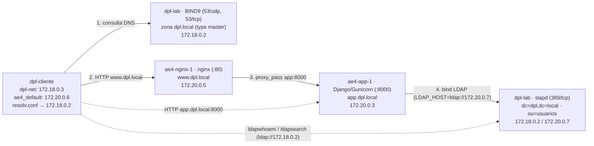

# AE6 — DNS y servicio de directorio para el despliegue

Microproyecto de la UT6: BIND9 (zona `dpl.local`) y OpenLDAP (`dc=dpl,dc=local`)
en el contenedor `dpl-lab`, integrados con la aplicación de la UT4.

Repositorio remoto: [GitHub](https://github.com/Jose-Glez-Hdez/AE6)

Autoría: imagen oficial de Ubuntu — https://hub.docker.com/_/ubuntu

## Arquitectura



| Contenedor | Redes e IPs | Servicio | Nombre DNS |
|---|---|---|---|
| dpl-cliente | dpl-net 172.18.0.3 · ae4_default 172.20.0.6 | Cliente de pruebas (dig, curl, ldap-utils) | — |
| dpl-lab | dpl-net 172.18.0.2 · ae4_default 172.20.0.7 | BIND9 (53) y slapd (389) | ns1.dpl.local |
| ae4-nginx-1 | ae4_default 172.20.0.5 | Servidor Web nginx, proxy a Django | www.dpl.local |
| ae4-app-1 | ae4_default 172.20.0.3 | Servidor de aplicaciones Django/Gunicorn | app.dpl.local |

Flujo de un login: el cliente resuelve `www.dpl.local` con BIND9 (1), envía la
petición a nginx (2), que la reenvía a Django (3), y Django valida las credenciales
haciendo un bind contra slapd (4). Las flechas discontinuas son las comprobaciones
directas desde el cliente.

dpl-lab está en las dos redes: en `dpl-net` atiende al cliente (DNS y LDAP) y en
`ae4_default` atiende a la aplicación (LDAP).


## 1. Instalación de BIND9 en dpl-lab

La instalación se hace dentro del contenedor `dpl-lab`:

```bash
docker exec dpl-lab bash -c "apt-get update && apt-get install -y bind9"
docker exec dpl-lab named -v
```

Salida:

```bash
docker exec dpl-lab named -v
BIND 9.18.39-0ubuntu0.24.04.9-Ubuntu (Extended Support Version) <id:>
docker exec dpl-lab ls /etc/bind
bind.keys
db.0
db.127
db.255
db.empty
db.local
named.conf
named.conf.default-zones
named.conf.local
named.conf.options
rndc.key
zones.rfc1918
```

## 2. Fichero de zona dpl.local

IPs del entorno (obtenidas con `docker inspect`):

| Contenedor | Red | IP | Nombre DNS |
|---|---|---|---|
| dpl-lab | dpl-net | 172.18.0.2 | ns1.dpl.local |
| ae4-nginx-1 | ae4_default | 172.20.0.5 | www.dpl.local |
| ae4-app-1 | ae4_default | 172.20.0.3 | app.dpl.local |

```bash
docker inspect -f '{{range .NetworkSettings.Networks}}{{.IPAddress}}{{end}}' dpl-lab
docker inspect -f '{{range .NetworkSettings.Networks}}{{.IPAddress}} {{end}}' ae4-nginx-1 ae4-app-1
```

El fichero `dns/dpl.local.db` se copia a `/etc/bind/db.dpl.local` en dpl-lab:

```bash
docker exec -i dpl-lab bash -c 'cat > /etc/bind/db.dpl.local' < dns/dpl.local.db
```

Significado de los registros:

- **SOA** (Start of Authority): identifica el servidor principal de la zona
  (`ns1.dpl.local.`), el contacto del administrador (`admin.dpl.local.`, es decir,
  admin@dpl.local), el **serial** (versión de la zona, formato AAAAMMDDnn, que se
  incrementa en cada cambio) y los temporizadores refresh, retry, expire y TTL mínimo.
- **NS**: indica qué servidor es autoritativo para `dpl.local` (`ns1.dpl.local.`).
  Como ese nombre pertenece a la propia zona, necesita su registro A (`ns1`).
- **A**: asocia un nombre con una IPv4. `www` apunta al contenedor nginx (servidor
  Web) y `app` al contenedor Django/Gunicorn (servidor de aplicaciones).
  `app.dpl.local` necesita su propio registro A porque es un servicio distinto, con
  otra IP: sin él, el nombre no resuelve (NXDOMAIN) y no se puede acceder por
  nombre al servidor de aplicaciones.
- `$ORIGIN dpl.local.` completa los nombres relativos, y los nombres absolutos llevan
  punto final.

Validación del fichero de zona:

```bash
docker exec dpl-lab named-checkzone dpl.local /etc/bind/db.dpl.local
zone dpl.local/IN: loaded serial 2026111501
OK
```

## 3. Declaración de la zona y validación

El fichero `dns/named.conf.local` se copia a `/etc/bind/named.conf.local` en dpl-lab
(el `named.conf` principal ya lo incluye):

```bash
docker exec -i dpl-lab bash -c 'cat > /etc/bind/named.conf.local' < dns/named.conf.local
```

```
zone "dpl.local" {
    type master;
    file "/etc/bind/db.dpl.local";
};
```

- `type master`: este servidor es autoritativo para la zona (la edita él).
- `file`: ruta del fichero con los registros de la zona.

Validación de la configuración y de la zona:

```bash
docker exec dpl-lab named-checkconf; echo "código de salida: $?"
código de salida: 0
docker exec dpl-lab named-checkzone dpl.local /etc/bind/db.dpl.local
zone dpl.local/IN: loaded serial 2026111501
OK
```

`named-checkconf` no produce salida cuando la configuración es correcta (código 0);
`named-checkzone` termina en `OK`.

## 4. Arranque de named sin systemd

El contenedor no ejecuta systemd, así que `named` se lanza en foreground (`-g`)
y `docker exec -d` lo mantiene en segundo plano dentro de dpl-lab:

```bash
docker exec -d dpl-lab named -g
```

Comprobación por proceso y puerto (53 en UDP y TCP):

```bash
docker exec dpl-lab pgrep -a named
456 named -g
docker exec dpl-lab ss -lunp | grep ':53'
UNCONN 0      0         172.18.0.2:53         0.0.0.0:*    users:(("named",pid=456,fd=100))
UNCONN 0      0         172.18.0.2:53         0.0.0.0:*    users:(("named",pid=456,fd=98)) 
UNCONN 0      0         172.18.0.2:53         0.0.0.0:*    users:(("named",pid=456,fd=96)) 
UNCONN 0      0         172.18.0.2:53         0.0.0.0:*    users:(("named",pid=456,fd=97)) 
UNCONN 0      0         172.18.0.2:53         0.0.0.0:*    users:(("named",pid=456,fd=101))
UNCONN 0      0         172.18.0.2:53         0.0.0.0:*    users:(("named",pid=456,fd=99)) 
UNCONN 0      0         172.18.0.2:53         0.0.0.0:*    users:(("named",pid=456,fd=102))
UNCONN 0      0         172.18.0.2:53         0.0.0.0:*    users:(("named",pid=456,fd=95)) 
UNCONN 0      0          127.0.0.1:53         0.0.0.0:*    users:(("named",pid=456,fd=77)) 
UNCONN 0      0          127.0.0.1:53         0.0.0.0:*    users:(("named",pid=456,fd=76)) 
UNCONN 0      0          127.0.0.1:53         0.0.0.0:*    users:(("named",pid=456,fd=78)) 
UNCONN 0      0          127.0.0.1:53         0.0.0.0:*    users:(("named",pid=456,fd=75)) 
UNCONN 0      0          127.0.0.1:53         0.0.0.0:*    users:(("named",pid=456,fd=73)) 
UNCONN 0      0          127.0.0.1:53         0.0.0.0:*    users:(("named",pid=456,fd=72)) 
UNCONN 0      0          127.0.0.1:53         0.0.0.0:*    users:(("named",pid=456,fd=74)) 
UNCONN 0      0          127.0.0.1:53         0.0.0.0:*    users:(("named",pid=456,fd=71)) 
UNCONN 0      0              [::1]:53            [::]:*    users:(("named",pid=456,fd=111))
UNCONN 0      0              [::1]:53            [::]:*    users:(("named",pid=456,fd=112))
UNCONN 0      0              [::1]:53            [::]:*    users:(("named",pid=456,fd=113))
UNCONN 0      0              [::1]:53            [::]:*    users:(("named",pid=456,fd=114))
UNCONN 0      0              [::1]:53            [::]:*    users:(("named",pid=456,fd=115))
UNCONN 0      0              [::1]:53            [::]:*    users:(("named",pid=456,fd=116))
UNCONN 0      0              [::1]:53            [::]:*    users:(("named",pid=456,fd=117))
UNCONN 0      0              [::1]:53            [::]:*    users:(("named",pid=456,fd=118))
docker exec dpl-lab ss -lntp | grep ':53'
LISTEN 0      10         127.0.0.1:53         0.0.0.0:*    users:(("named",pid=456,fd=93)) 
LISTEN 0      10         127.0.0.1:53         0.0.0.0:*    users:(("named",pid=456,fd=91)) 
LISTEN 0      10         127.0.0.1:53         0.0.0.0:*    users:(("named",pid=456,fd=89)) 
LISTEN 0      10         127.0.0.1:53         0.0.0.0:*    users:(("named",pid=456,fd=83)) 
LISTEN 0      10         127.0.0.1:53         0.0.0.0:*    users:(("named",pid=456,fd=87)) 
LISTEN 0      10         127.0.0.1:53         0.0.0.0:*    users:(("named",pid=456,fd=81)) 
LISTEN 0      10         127.0.0.1:53         0.0.0.0:*    users:(("named",pid=456,fd=84)) 
LISTEN 0      10         127.0.0.1:53         0.0.0.0:*    users:(("named",pid=456,fd=79)) 
LISTEN 0      10        172.18.0.2:53         0.0.0.0:*    users:(("named",pid=456,fd=109))
LISTEN 0      10        172.18.0.2:53         0.0.0.0:*    users:(("named",pid=456,fd=110))
LISTEN 0      10        172.18.0.2:53         0.0.0.0:*    users:(("named",pid=456,fd=108))
LISTEN 0      10        172.18.0.2:53         0.0.0.0:*    users:(("named",pid=456,fd=107))
LISTEN 0      10        172.18.0.2:53         0.0.0.0:*    users:(("named",pid=456,fd=106))
LISTEN 0      10        172.18.0.2:53         0.0.0.0:*    users:(("named",pid=456,fd=105))
LISTEN 0      10        172.18.0.2:53         0.0.0.0:*    users:(("named",pid=456,fd=104))
LISTEN 0      10        172.18.0.2:53         0.0.0.0:*    users:(("named",pid=456,fd=103))
LISTEN 0      10             [::1]:53            [::]:*    users:(("named",pid=456,fd=119))
LISTEN 0      10             [::1]:53            [::]:*    users:(("named",pid=456,fd=120))
LISTEN 0      10             [::1]:53            [::]:*    users:(("named",pid=456,fd=121))
LISTEN 0      10             [::1]:53            [::]:*    users:(("named",pid=456,fd=123))
LISTEN 0      10             [::1]:53            [::]:*    users:(("named",pid=456,fd=124))
LISTEN 0      10             [::1]:53            [::]:*    users:(("named",pid=456,fd=126))
LISTEN 0      10             [::1]:53            [::]:*    users:(("named",pid=456,fd=122))
LISTEN 0      10             [::1]:53            [::]:*    users:(("named",pid=456,fd=125))
```

**Arranque automático:** no probado (sin systemd en contenedor). Si se reinicia
dpl-lab hay que relanzar `docker exec -d dpl-lab named -g`. En una máquina con
systemd se usaría `systemctl enable --now named`.

## 5. Configuración del cliente (dpl-cliente)

Herramientas de consulta (instaladas antes de cambiar el resolvedor):

```bash
docker exec dpl-cliente bash -c "apt-get update && apt-get install -y dnsutils iputils-ping"
```

Resolvedor apuntando al BIND9 de dpl-lab, sin usar `/etc/hosts`:

```bash
docker exec dpl-cliente bash -c "echo 'nameserver 172.18.0.2' > /etc/resolv.conf && echo 'nameserver 1.1.1.1' >> /etc/resolv.conf && echo 'search dpl.local' >> /etc/resolv.conf"
docker exec dpl-cliente cat /etc/resolv.conf
nameserver 172.18.0.2
nameserver 1.1.1.1
search dpl.local
```

- `nameserver 172.18.0.2`: el BIND9 de dpl-lab (primero en consultarse).
- `nameserver 1.1.1.1`: respaldo para nombres de Internet.
- `search dpl.local`: completa nombres cortos (`www` → `www.dpl.local`).

Conexión a la red de la aplicación (los contenedores nginx y Django están en
`ae4_default`, no en `dpl-net`):

```bash
docker network connect ae4_default dpl-cliente
docker inspect -f '{{range $k,$v := .NetworkSettings.Networks}}{{$k}}={{$v.IPAddress}} {{end}}' dpl-cliente
ae4_default=172.20.0.6 dpl-net=172.18.0.3 
```
## 6. Comprobación de la resolución y acceso por nombre

Desde dpl-cliente, sin entradas en `/etc/hosts` (salidas completas en
`comprobaciones.txt`):

```bash
docker exec dpl-cliente grep dpl.local /etc/hosts || echo "sin entradas locales (correcto)"
sin entradas locales (correcto)
docker exec dpl-cliente dig @172.18.0.2 www.dpl.local A +noall +answer
www.dpl.local.		3600	IN	A	172.20.0.5
docker exec dpl-cliente dig @172.18.0.2 app.dpl.local A +noall +answer
app.dpl.local.		3600	IN	A	172.20.0.3
docker exec dpl-cliente host -t ns dpl.local
dpl.local name server ns1.dpl.local.
docker exec dpl-cliente ping -c 3 www.dpl.local
PING www.dpl.local (172.20.0.5) 56(84) bytes of data.
64 bytes from 172.20.0.5: icmp_seq=1 ttl=64 time=0.370 ms
64 bytes from 172.20.0.5: icmp_seq=2 ttl=64 time=0.307 ms
64 bytes from 172.20.0.5: icmp_seq=3 ttl=64 time=0.176 ms

--- www.dpl.local ping statistics ---
3 packets transmitted, 3 received, 0% packet loss, time 2072ms
rtt min/avg/max/mdev = 0.176/0.284/0.370/0.080 ms
docker exec dpl-cliente curl -I http://www.dpl.local
  % Total    % Received % Xferd  Average Speed   Time    Time     Time  Current
                                 Dload  Upload   Total   Spent    Left  Speed
  0     0    0     0    0     0      0      0 --:--:-- --:--:-- --:--:--     0
HTTP/1.1 200 OK
Server: nginx/1.27.5
Date: Sun, 15 Nov 2026 13:21:09 GMT
Content-Type: text/html; charset=utf-8
Connection: keep-alive
docker exec dpl-cliente curl -s http://app.dpl.local:8000/api/mensaje
{"mensaje": "Hola desde el servidor de aplicaciones", "hostname": "2430284e2de3", "fecha": "2026-11-15T14:21:25+01:00"}%  
```

- `www.dpl.local` → 172.20.0.5 (nginx, puerto 80), que reenvía las peticiones a
  Django (`proxy_pass http://app:8000`).
- `app.dpl.local` → 172.20.0.3 (Django/Gunicorn, puerto 8000 interno).
- La resolución depende del BIND9 de dpl-lab: el cliente no tiene entradas en
  `/etc/hosts` y su `resolv.conf` apunta a 172.18.0.2.

## 7. Instalación de OpenLDAP (slapd) en dpl-lab

Instalación desatendida dentro del contenedor, preseleccionando las respuestas del
asistente con `debconf-set-selections` para que la base sea `dc=dpl,dc=local`:

```bash
docker exec dpl-lab bash -c "\
  echo 'slapd slapd/domain string dpl.local' | debconf-set-selections &&\
  echo 'slapd shared/organization string DPL' | debconf-set-selections &&\
  echo 'slapd slapd/password1 password CAMBIAR_ESTO' | debconf-set-selections &&\
  echo 'slapd slapd/password2 password CAMBIAR_ESTO' | debconf-set-selections &&\
  echo 'slapd slapd/backend select MDB' | debconf-set-selections &&\
  echo 'slapd slapd/purge_database boolean false' | debconf-set-selections &&\
  echo 'slapd slapd/move_old_database boolean true' | debconf-set-selections &&\
  apt-get update && DEBIAN_FRONTEND=noninteractive apt-get install -y slapd ldap-utils"
```

- `slapd/domain dpl.local` → base del árbol `dc=dpl,dc=local`.
- Administrador del directorio: `cn=admin,dc=dpl,dc=local`.
- `ldap-utils` aporta los clientes `ldapsearch`, `ldapadd` y `ldapwhoami`.

Verificación de la base con `slapcat` (lee directamente la base, sin red):

```bash
docker exec dpl-lab slapcat
dn: dc=dpl,dc=local
objectClass: top
objectClass: dcObject
objectClass: organization
o: DPL
dc: dpl
structuralObjectClass: organization
entryUUID: 12f48eec-7544-1041-89ff-4b607e5c8ebb
creatorsName: cn=admin,dc=dpl,dc=local
createTimestamp: 20261115132739Z
entryCSN: 20261115132739.743566Z#000000#000#000000
modifiersName: cn=admin,dc=dpl,dc=local
modifyTimestamp: 20261115132739Z
```
## 8. Arranque de slapd sin systemd

`slapd` se lanza en foreground (`-d 0`, nivel de depuración 0) escuchando LDAP en
el puerto 389 (`-h ldap:///`); `docker exec -d` lo mantiene en segundo plano:

```bash
docker exec -d dpl-lab slapd -d 0 -h ldap:///
```

Comprobación por proceso, puerto y base:

```bash
docker exec dpl-lab pgrep -a slapd
1090 slapd -d 0 -h ldap:///
docker exec dpl-lab ss -lntp | grep ':389'
LISTEN 0      2048         0.0.0.0:389        0.0.0.0:*    users:(("slapd",pid=1090,fd=6)) 
LISTEN 0      2048            [::]:389           [::]:*    users:(("slapd",pid=1090,fd=7)) 
docker exec dpl-lab ldapsearch -x -LLL -b "dc=dpl,dc=local" "objectClass=*" dn
dn: dc=dpl,dc=local
```

Cliente LDAP en dpl-cliente y consulta por red (en OpenLDAP 2.6 el host se indica
con `-H ldap://IP`; la opción `-h` ya no existe):

```bash
docker exec dpl-cliente bash -c "apt-get update && apt-get install -y ldap-utils"
docker exec dpl-cliente ldapsearch -x -LLL -H ldap://172.18.0.2 -b "dc=dpl,dc=local" "objectClass=*" dn
Hit:1 http://ports.ubuntu.com/ubuntu-ports noble InRelease
Hit:2 http://ports.ubuntu.com/ubuntu-ports noble-updates InRelease
Hit:3 http://ports.ubuntu.com/ubuntu-ports noble-backports InRelease
Hit:4 http://ports.ubuntu.com/ubuntu-ports noble-security InRelease
Reading package lists...
Reading package lists...
Building dependency tree...
Reading state information...
Suggested packages:
  libsasl2-modules-gssapi-mit | libsasl2-modules-gssapi-heimdal
The following NEW packages will be installed:
  ldap-utils
0 upgraded, 1 newly installed, 0 to remove and 13 not upgraded.
Need to get 149 kB of archives.
After this operation, 811 kB of additional disk space will be used.
Get:1 http://ports.ubuntu.com/ubuntu-ports noble-updates/main arm64 ldap-utils arm64 2.6.10+dfsg-0ubuntu0.24.04.1 [149 kB]
debconf: delaying package configuration, since apt-utils is not installed
Fetched 149 kB in 1s (155 kB/s)
Selecting previously unselected package ldap-utils.
(Reading database ... 5593 files and directories currently installed.)
Preparing to unpack .../ldap-utils_2.6.10+dfsg-0ubuntu0.24.04.1_arm64.deb ...
Unpacking ldap-utils (2.6.10+dfsg-0ubuntu0.24.04.1) ...
Setting up ldap-utils (2.6.10+dfsg-0ubuntu0.24.04.1) ...
dn: dc=dpl,dc=local
```

**Arranque automático:** no probado (sin systemd en contenedor). Si se reinicia
dpl-lab hay que relanzar `docker exec -d dpl-lab slapd -d 0 -h ldap:///`.

## 9. Usuarios del directorio (LDIF)

`ldif/usuarios.ldif` crea la unidad organizativa `ou=usuarios` y los usuarios
`alumno` y `maria` (clase `inetOrgPerson`, contraseña de laboratorio
`CAMBIAR_ESTO`, no real):

- `dn`: nombre distinguido, la ruta completa de la entrada en el árbol.
- `organizationalUnit`: agrupa a los usuarios bajo `ou=usuarios,dc=dpl,dc=local`.
- `inetOrgPerson`: define los atributos de una persona (`uid`, `cn`, `sn`, `mail`,
  `userPassword`). El `uid` es el nombre de inicio de sesión.

Carga desde dpl-cliente autenticándose como administrador:

```bash
docker cp ~/dpl/AE6/ldif/usuarios.ldif dpl-cliente:/tmp/usuarios.ldif
docker exec -it dpl-cliente ldapadd -x -H ldap://172.18.0.2 -D "cn=admin,dc=dpl,dc=local" -W -f /tmp/usuarios.ldif
Successfully copied 390B (transferred 2.05kB) to dpl-cliente:/tmp/usuarios.ldif
Enter LDAP Password: 
adding new entry "ou=usuarios,dc=dpl,dc=local"

adding new entry "uid=alumno,ou=usuarios,dc=dpl,dc=local"

adding new entry "uid=maria,ou=usuarios,dc=dpl,dc=local"
```

`-D` indica el DN con el que se autentica y `-W` pide la contraseña sin dejarla en
el historial.

Árbol resultante visto por red:

```bash
docker exec dpl-cliente ldapsearch -x -LLL -H ldap://172.18.0.2 -b "dc=dpl,dc=local" "objectClass=*" dn
dn: dc=dpl,dc=local

dn: ou=usuarios,dc=dpl,dc=local

dn: uid=alumno,ou=usuarios,dc=dpl,dc=local

dn: uid=maria,ou=usuarios,dc=dpl,dc=local
```

## 10. Autenticación contra el directorio y volcado

El *bind* (autenticarse con un DN y una contraseña) es lo que hace la aplicación
en `/api/login`. Desde dpl-cliente:

```bash
docker exec dpl-cliente ldapwhoami -x -H ldap://172.18.0.2 -D "uid=alumno,ou=usuarios,dc=dpl,dc=local" -w CAMBIAR_ESTO
dn:uid=alumno,ou=usuarios,dc=dpl,dc=local
docker exec dpl-cliente ldapwhoami -x -H ldap://172.18.0.2 -D "uid=alumno,ou=usuarios,dc=dpl,dc=local" -w incorrecta
ldap_bind: Invalid credentials (49)
```

Con la contraseña correcta se confirma el DN; con una incorrecta el directorio
rechaza el bind con `Invalid credentials (49)`.

Búsqueda del perfil (lo que hace la aplicación tras autenticar):

```bash
docker exec dpl-cliente ldapsearch -x -LLL -H ldap://172.18.0.2 -b "ou=usuarios,dc=dpl,dc=local" "(uid=alumno)" cn mail
dn: uid=alumno,ou=usuarios,dc=dpl,dc=local
cn: alumno
mail: alumno@dpl.local
```

Volcado completo con `slapcat` (lee la base directamente en el servidor; sirve
como verificación y copia de seguridad). Salida completa en `comprobaciones.txt`:

```bash
docker exec dpl-lab slapcat
dn: dc=dpl,dc=local
objectClass: top
objectClass: dcObject
objectClass: organization
o: DPL
dc: dpl
structuralObjectClass: organization
entryUUID: 12f48eec-7544-1041-89ff-4b607e5c8ebb
creatorsName: cn=admin,dc=dpl,dc=local
createTimestamp: 20261115132739Z
entryCSN: 20261115132739.743566Z#000000#000#000000
modifiersName: cn=admin,dc=dpl,dc=local
modifyTimestamp: 20261115132739Z

dn: ou=usuarios,dc=dpl,dc=local
objectClass: organizationalUnit
ou: usuarios
structuralObjectClass: organizationalUnit
entryUUID: 704ffb48-7545-1041-890e-cda239db4dac
creatorsName: cn=admin,dc=dpl,dc=local
createTimestamp: 20261115133725Z
entryCSN: 20261115133725.867473Z#000000#000#000000
modifiersName: cn=admin,dc=dpl,dc=local
modifyTimestamp: 20261115133725Z

dn: uid=alumno,ou=usuarios,dc=dpl,dc=local
objectClass: inetOrgPerson
uid: alumno
cn: alumno
sn: Alumno DPL
mail: alumno@dpl.local
userPassword:: Q0FNQklBUl9FU1RP
structuralObjectClass: inetOrgPerson
entryUUID: 7050e1fc-7545-1041-890f-cda239db4dac
creatorsName: cn=admin,dc=dpl,dc=local
createTimestamp: 20261115133725Z
entryCSN: 20261115133725.873472Z#000000#000#000000
modifiersName: cn=admin,dc=dpl,dc=local
modifyTimestamp: 20261115133725Z

dn: uid=maria,ou=usuarios,dc=dpl,dc=local
objectClass: inetOrgPerson
uid: maria
cn: maria
sn: Maria DPL
mail: maria@dpl.local
userPassword:: Q0FNQklBUl9FU1RP
structuralObjectClass: inetOrgPerson
entryUUID: 70514f48-7545-1041-8910-cda239db4dac
creatorsName: cn=admin,dc=dpl,dc=local
createTimestamp: 20261115133725Z
entryCSN: 20261115133725.876273Z#000000#000#000000
modifiersName: cn=admin,dc=dpl,dc=local
modifyTimestamp: 20261115133725Z
```

`userPassword::` aparece en Base64 (doble `::`), que es una codificación y no un
cifrado: cualquiera con acceso a `slapcat` puede decodificarla.

## 11. Adaptación de /api/login de la aplicación (repo ae4)

**Problema encontrado:** el endpoint `/api/login` de la aplicación de la UT4
construía el DN del usuario con `ou=people` fijo en el código e ignoraba
`LDAP_USER_FILTER`:

```python
user_dn = f"uid={usuario},ou=people,{base_dn}"
```

El directorio de la AE6 usa `ou=usuarios`, así que el bind fallaba siempre (401)
incluso con la contraseña correcta, y no se podía configurar por variables de entorno.

**Solución:** se sustituye la función por la implementación del material del curso
(commit `3a806bd` del repositorio `ae4`), que sigue el esquema de la teoría
(bind + búsqueda con ldap3):

| Parámetro | Variable | Valor |
|---|---|---|
| Host | `LDAP_HOST` | URL del directorio en dpl-lab (paso siguiente) |
| Base DN | `LDAP_BASE_DN` | `ou=usuarios,dc=dpl,dc=local` |
| Filtro | `LDAP_USER_FILTER` | `(uid=%s)` (`%s` = usuario tecleado) |
| Bind | — | `uid=<usuario>,ou=usuarios,dc=dpl,dc=local` + contraseña recibida |

Respuestas: 200 `{"autenticado": true, "perfil": {cn, mail}}` si el bind funciona,
401 si el directorio rechaza las credenciales, 400 si faltan datos y 503 si no hay
`LDAP_HOST`.

## 12. Configuración del despliegue para autenticar contra el directorio

Variables añadidas al servicio `app` en `compose.yml` (repo ae4, commit `3fb0dce`):

```yaml
      LDAP_HOST: ${LDAP_HOST:-}
      LDAP_BASE_DN: ${LDAP_BASE_DN:-ou=usuarios,dc=dpl,dc=local}
      LDAP_USER_FILTER: ${LDAP_USER_FILTER:-(uid=%s)}
```

La app y dpl-lab deben compartir red: se conecta dpl-lab a la red del proyecto
Compose (`ae4_default`), donde recibe la IP `172.20.0.7`:

```bash
docker network connect ae4_default dpl-lab
docker inspect -f '{{range $k,$v := .NetworkSettings.Networks}}{{$k}}={{$v.IPAddress}} {{end}}' dpl-lab
ae4_default=172.20.0.7 dpl-net=172.18.0.2
```

Despliegue con `LDAP_HOST` apuntando a dpl-lab en esa red (no a 172.18.0.2, que
está en dpl-net y la app no alcanza):

```bash
export LDAP_HOST="ldap://172.20.0.7"
docker compose up -d --build
docker compose exec app env | grep LDAP
[+] Building 2.3s (13/13) FINISHED                                                                                                                  
 => [internal] load local bake definitions                                                                                                     0.0s
 => => reading from stdin 500B                                                                                                                 0.0s
 => [internal] load build definition from dockerfile                                                                                           0.0s
 => => transferring dockerfile: 406B                                                                                                           0.0s
 => [internal] load metadata for docker.io/library/python:3.12-slim                                                                            1.5s
 => [internal] load .dockerignore                                                                                                              0.0s
 => => transferring context: 2B                                                                                                                0.0s
 => [1/6] FROM docker.io/library/python:3.12-slim@sha256:5e2bdb1b0d542d5039cffb8181c65930093949194a65c365dfb1b0fe13a4fa5b                      0.0s
 => => resolve docker.io/library/python:3.12-slim@sha256:5e2bdb1b0d542d5039cffb8181c65930093949194a65c365dfb1b0fe13a4fa5b                      0.0s
 => [internal] load build context                                                                                                              0.5s
 => => transferring context: 1.35MB                                                                                                            0.5s
 => CACHED [2/6] WORKDIR /app                                                                                                                  0.0s
 => CACHED [3/6] COPY requirements.txt .                                                                                                       0.0s
 => CACHED [4/6] RUN pip install --no-cache-dir -r requirements.txt                                                                            0.0s
 => CACHED [5/6] COPY . .                                                                                                                      0.0s
 => CACHED [6/6] RUN useradd --create-home --uid 1000 appuser     && mkdir -p /data     && chown appuser:appuser /data                         0.0s
 => exporting to image                                                                                                                         0.0s
 => => exporting layers                                                                                                                        0.0s
 => => exporting manifest sha256:3f350b08e642ef2baaa563692c6fd3b4ea3105fa0cfba1fe5873b623ef8325c4                                              0.0s
 => => exporting config sha256:7c3a035c0f4fadd5e7ff6171905c770fc8eb7054ebe15a86a0f803741756b84c                                                0.0s
 => => exporting attestation manifest sha256:da7b0fbb99490c23eccc98ead0d17876d3a44bfe2997e99927f645686a7f8208                                  0.0s
 => => exporting manifest list sha256:419f9fe944ca7c4f9f61bf831a04b9091bf5d32238330bc58a5a0250ccdc4ac9                                         0.0s
 => => naming to docker.io/library/ae4-app:latest                                                                                              0.0s
 => => unpacking to docker.io/library/ae4-app:latest                                                                                           0.0s
 => resolving provenance for metadata file                                                                                                     0.0s
[+] up 5/5
 ✔ Image ae4-app           Built                                                                                                                2.3s
 ✔ Container ae4-pgadmin-1 Running                                                                                                              0.0s
 ✔ Container ae4-app-1     Healthy                                                                                                              1.0s
 ✔ Container ae4-nginx-1   Running                                                                                                              0.0s
 ✔ Container ae4-db-1      Healthy                                                                                                              0.5s
LDAP_USER_FILTER=(uid=%s)
LDAP_HOST=ldap://172.20.0.7
LDAP_BASE_DN=ou=usuarios,dc=dpl,dc=local
```

## 13. Login de la aplicación contra el directorio

Desde dpl-cliente y por nombre (salidas completas en `comprobaciones.txt`):

```bash
docker exec dpl-cliente curl -s -X POST -d "usuario=alumno&password=CAMBIAR_ESTO" http://www.dpl.local/api/login
{"autenticado": true, "usuario": "alumno", "perfil": {"cn": "alumno", "mail": "alumno@dpl.local"}}% 
docker exec dpl-cliente curl -s -o /dev/null -w '%{http_code}\n' -X POST -d "usuario=alumno&password=CAMBIAR_ESTO" http://www.dpl.local/api/login
200
docker exec dpl-cliente curl -s -o /dev/null -w '%{http_code}\n' -X POST -d "usuario=alumno&password=incorrecta" http://www.dpl.local/api/login
401
```

Cadena completa de una petición de login:

1. dpl-cliente resuelve `www.dpl.local` con el BIND9 de dpl-lab (172.18.0.2) → 172.20.0.5.
2. nginx recibe la petición en el puerto 80 y la reenvía a `app:8000` (Gunicorn).
3. Django hace el *bind* contra slapd (`ldap://172.20.0.7`) con el DN
   `uid=alumno,ou=usuarios,dc=dpl,dc=local` y la contraseña recibida.
4. Si el bind funciona, busca con el filtro `(uid=alumno)` en `ou=usuarios,dc=dpl,dc=local`
   y devuelve `cn` y `mail` (200); si el directorio rechaza las credenciales
   (error 49), responde 401.

## 14. Script de comprobación automática

`scripts/comprobar.sh` parte de la plantilla del enunciado y la amplía para cubrir
toda la checklist: puertos 53/udp y 389/tcp, registro NS, ausencia de `dpl.local`
en `/etc/hosts` del cliente, `ou=usuarios` y los usuarios `alumno` y `maria`,
acceso por nombre a la Web y a la aplicación, y login correcto (200) e
incorrecto (401).

- Es **idempotente**: solo consulta el estado, no modifica nada.
- Usa `set -u` (sin `-e`, para que un fallo no corte el script y se cuenten todos).
- Devuelve **0** si todo pasa y **1** si alguna comprobación falla.

Ejecución con todos los servicios activos:

```bash
IP_DPL_LAB=172.18.0.2 ./scripts/comprobar.sh; echo "código de salida: $?"
== DNS ==
[OK]   named-checkconf
[OK]   named-checkzone
[OK]   named activo
[OK]   puerto 53/udp escuchando
[OK]   www.dpl.local -> 172.20.0.5
[OK]   app.dpl.local -> 172.20.0.3
[OK]   registro NS ns1.dpl.local
[OK]   sin dpl.local en /etc/hosts del cliente
== Directorio ==
[OK]   slapd activo
[OK]   puerto 389/tcp escuchando
[OK]   ou=usuarios en el directorio
[OK]   usuario alumno en el directorio
[OK]   usuario maria en el directorio
[OK]   bind correcto
[OK]   bind incorrecto rechazado
== Integración ==
[OK]   Web por nombre (200)
[OK]   aplicación por nombre (200)
[OK]   login LDAP (200)
[OK]   login incorrecto rechazado (401)

Resultado: todas las comprobaciones han pasado.
código de salida: 0
```

Ejecución con `slapd` parado (fallo controlado), que demuestra que el script
detecta los fallos:

```bash
docker exec dpl-lab pkill slapd
IP_DPL_LAB=172.18.0.2 ./scripts/comprobar.sh; echo "código de salida: $?"
== DNS ==
[OK]   named-checkconf
[OK]   named-checkzone
[OK]   named activo
[OK]   puerto 53/udp escuchando
[OK]   www.dpl.local -> 172.20.0.5
[OK]   app.dpl.local -> 172.20.0.3
[OK]   registro NS ns1.dpl.local
[OK]   sin dpl.local en /etc/hosts del cliente
== Directorio ==
[FALLO] slapd no activo
[FALLO] puerto 389/tcp
ldap_sasl_bind(SIMPLE): Can't contact LDAP server (-1)
[FALLO] ou=usuarios ausente
ldap_sasl_bind(SIMPLE): Can't contact LDAP server (-1)
[FALLO] usuario alumno ausente
ldap_sasl_bind(SIMPLE): Can't contact LDAP server (-1)
[FALLO] usuario maria ausente
ldap_sasl_bind(SIMPLE): Can't contact LDAP server (-1)
[FALLO] bind correcto rechazado
[OK]   bind incorrecto rechazado
== Integración ==
[OK]   Web por nombre (200)
[OK]   aplicación por nombre (200)
[FALLO] login LDAP
[OK]   login incorrecto rechazado (401)

Resultado: 7 comprobación(es) fallida(s).
código de salida: 1
docker exec -d dpl-lab slapd -d 0 -h ldap:///
```

## Informe de diagnóstico

Cada fallo se provocó de forma controlada en el entorno, se diagnosticó con los
comandos indicados y se corrigió. Una capa por fallo, siguiendo el camino de una
petición (ver diagrama de arquitectura).

### Fallo 1: DNS

- **Síntoma observado:** `curl` a `http://www.dpl.local` no obtiene respuesta y
  `ping` pierde el 100 % de los paquetes.

```bash
$ docker exec dpl-cliente curl -sI --max-time 5 http://www.dpl.local; echo "código de salida: $?"
código de salida: 7

$ docker exec dpl-cliente ping -c 2 -W 2 www.dpl.local
PING www.dpl.local (172.20.0.50) 56(84) bytes of data.

--- www.dpl.local ping statistics ---
2 packets transmitted, 0 received, 100% packet loss, time 1064ms
```

- **Causa:** el registro A de `www` en `/etc/bind/db.dpl.local` apuntaba a
  `172.20.0.50` (serial 2026111502), una IP sin servicio, en lugar de a nginx
  (`172.20.0.5`).
- **Comprobación:** `named` está activo y la zona es sintácticamente válida, pero
  `dig` devuelve una IP distinta de la real del contenedor nginx:

```bash
$ docker exec dpl-lab pgrep -a named
1482 named -g

$ docker exec dpl-cliente dig @172.18.0.2 www.dpl.local A +noall +answer
www.dpl.local.		3600	IN	A	172.20.0.50

$ docker inspect -f '{{range .NetworkSettings.Networks}}{{.IPAddress}}{{end}}' ae4-nginx-1
172.20.0.5

$ docker exec dpl-lab named-checkzone dpl.local /etc/bind/db.dpl.local
zone dpl.local/IN: loaded serial 2026111502
OK

$ docker exec dpl-lab grep -E 'serial|^www' /etc/bind/db.dpl.local
        2026111502 ; serial
www     IN  A   172.20.0.50
```

- **Corrección aplicada:** se restaura la zona desde `dns/dpl.local.db` (con `www`
  en 172.20.0.5) subiendo el serial a 2026111503, superior al erróneo, y se relanza
  `named`:

```bash
docker exec -i dpl-lab bash -c 'cat > /etc/bind/db.dpl.local' < dns/dpl.local.db
docker exec dpl-lab pkill named
docker exec -d dpl-lab named -g
```

- **Verificación final:**

```bash
$ docker exec dpl-lab named-checkzone dpl.local /etc/bind/db.dpl.local
zone dpl.local/IN: loaded serial 2026111503
OK

$ docker exec dpl-cliente dig @172.18.0.2 www.dpl.local A +noall +answer
www.dpl.local.		3600	IN	A	172.20.0.5

$ docker exec dpl-cliente curl -sI --max-time 5 http://www.dpl.local | head -2
HTTP/1.1 200 OK
Server: nginx/1.27.5

$ IP_DPL_LAB=172.18.0.2 ./scripts/comprobar.sh | tail -3
[OK]   login incorrecto rechazado (401)

Resultado: todas las comprobaciones han pasado.
```
